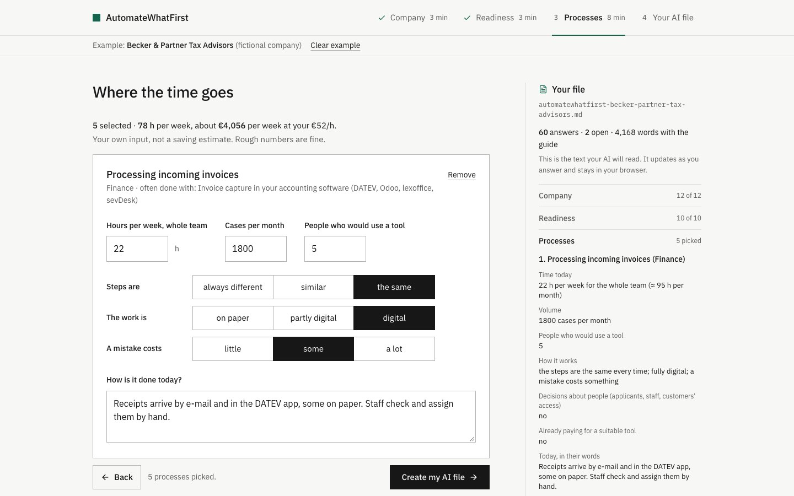
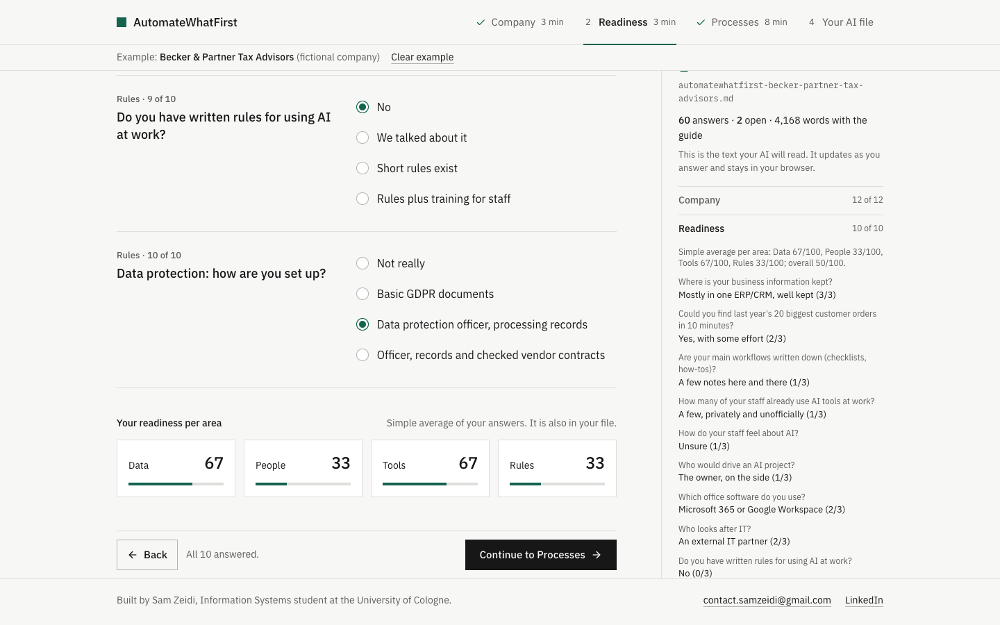
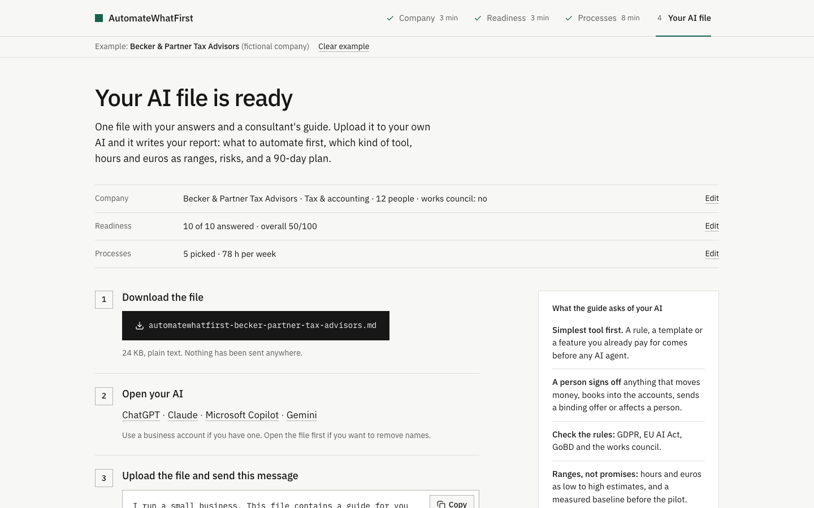
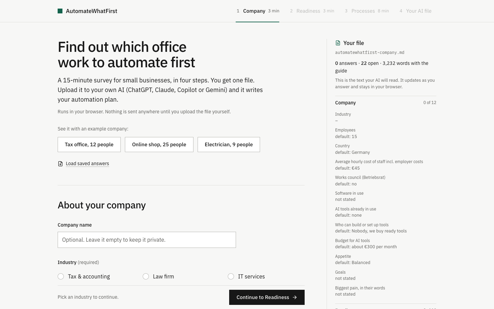
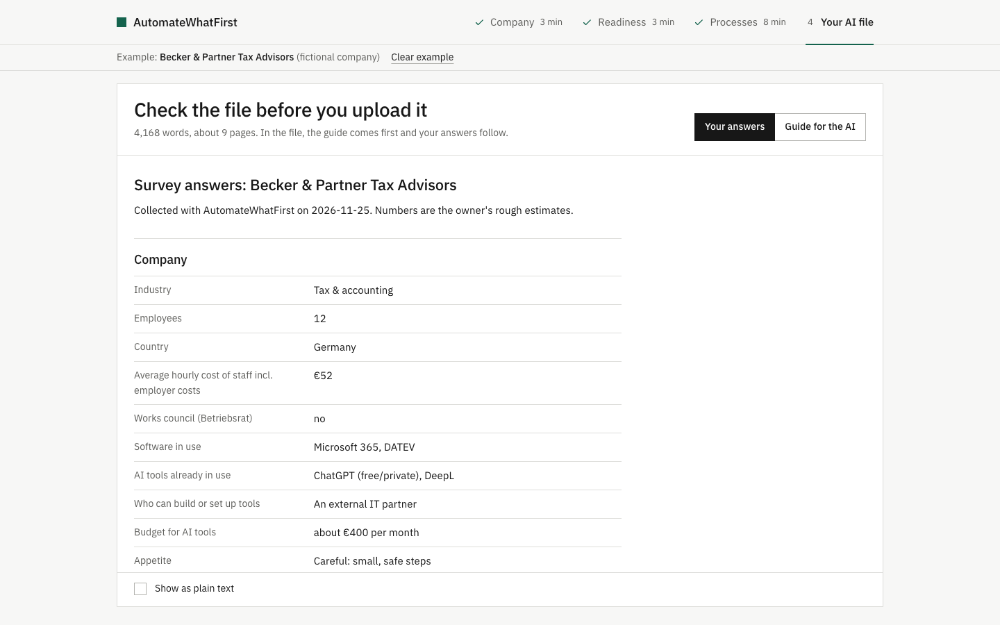
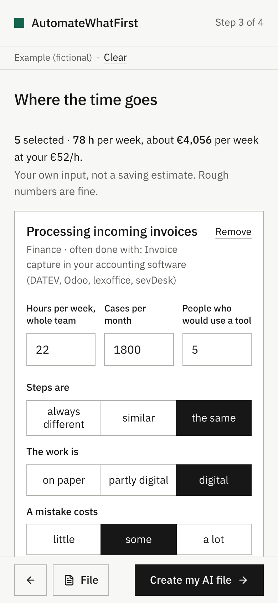

# AutomateWhatFirst

A 15-minute survey that helps a small business decide which office work to automate first.
The answers become one file. The owner uploads it to the AI they already use (ChatGPT, Claude, Copilot or Gemini), and that AI writes the automation plan.

**The problem:** small firms don't know which office process to automate first, and generic AI advice ignores GDPR, the works council (Betriebsrat), bookkeeping rules and cost.
**The answer:** collect the facts in a short survey, and give the AI a consultant's method to reason with.



Runs in the browser. No account, no server, no tracking. The page loads no fonts or scripts from other servers; nothing leaves the browser until the owner uploads the file.

## What I built

- **The survey design and question set:** company facts, ten readiness questions on data, people, tools and rules, and per-process questions (hours, cases, how repeatable, how digital, what a mistake costs, decisions about people).
- **A library of 24 common office processes** with reference values per process: typical share of time AI can help with, typical tools, cost per user, setup days, EU AI Act risk class and a safe first pilot ([`src/lib/library.ts`](src/lib/library.ts)). These are planning assumptions, not measurements.
- **The consultant guide for the AI** ([`AI-GUIDE.md`](AI-GUIDE.md)): how to split a process into tasks, pick the simplest kind of help, rank, estimate as ranges, check the rules and write a 90-day plan.
- **The export format:** one Markdown file, guide first, answers second, plus the message to send with it.
- **The app:** React and TypeScript, built into one self-contained HTML file (Vite), with a light and a dark theme.

Concept and product design by Sam Zeidi.

## How it works

1. **Company:** industry, size, hourly cost, country, works council, software and AI tools in use, who can build tools, budget, appetite, goals and the biggest pain in the owner's words.
2. **Readiness:** ten questions on data, written workflows, people, tools and rules. At the end the owner sees a simple average per area, which also goes into the file.
3. **Processes:** pick from the library or add your own, with rough numbers.
4. **Your AI file:** download it, open your AI, upload it with the suggested message.

While the owner answers, a panel on the right shows the answers part of the file line by line. Three fictional example companies (a tax office, an online shop, an electrician) fill everything in with one click and are marked as fictional on every step.

| Readiness per area | Step 4: the file and what to do with it |
|---|---|
|  |  |

## What the guide asks of the AI

- **Simplest tool first.** A rule, a template or a feature the company already pays for comes before any AI agent.
- **A person signs off** anything that moves money, books into the accounts, sends a binding offer or affects a person.
- **Check the rules:** GDPR, EU AI Act, GoBD (German bookkeeping rules) and the works council.
- **Ranges, not promises:** hours and euros as low to high estimates, a measured baseline before the pilot, and a keep, scale, change or stop decision after 90 days.
- **The owner's language:** the survey is in English; the AI writes the report in the language the owner writes to it, for example German.

Nothing here is legal advice.

## Design decisions

- **The survey collects facts; the AI does the reasoning.** An earlier version computed a readiness score and euro figures inside the app. Fixed formulas gave a false sense of precision, so the logic moved into a written method that any good AI can follow and the owner can read.
- **The simplest tool first.** Many office tasks are solved by a rule in the software the firm already has. Recommending an AI agent for those wastes money and adds risk.
- **A person signs off anything that moves money or affects people.** AI output varies and is sometimes wrong; GoBD and the GDPR (Article 22) also expect a person to stay in control.
- **No server.** Owners describe their business in detail. Keeping everything in the browser means there is nothing to store, secure or delete.

## Part 1 of 3: decide, build, measure

AutomateWhatFirst decides what to automate. InboxToOdoo, my second project, automates an approval process in Odoo with n8n. IsAIWorthIt, my third, measures whether AI tools pay off per team and month. The repositories are private; demos are on request.

## Run locally

```bash
npm install
npm run dev        # development
npm run build      # one self-contained file: dist/index.html
```

`dist/index.html` works offline, fonts included. It can be opened from a USB stick or sent as a file. Add `?theme=dark` for the dark theme.

The GitHub Pages workflow in `.github/workflows/pages.yml` runs only when started by hand; nothing is published on push. The public demo is the copy on my portfolio.

## Screens

| Start | File preview | Phone |
|---|---|---|
|  |  |  |

## Contact

Sam Zeidi, Information Systems student at the University of Cologne. contact.samzeidi@gmail.com

## License

Apache-2.0. Third-party components, including the IBM Plex fonts, are listed in [THIRD_PARTY_NOTICES.md](THIRD_PARTY_NOTICES.md). The example companies are fictional.
